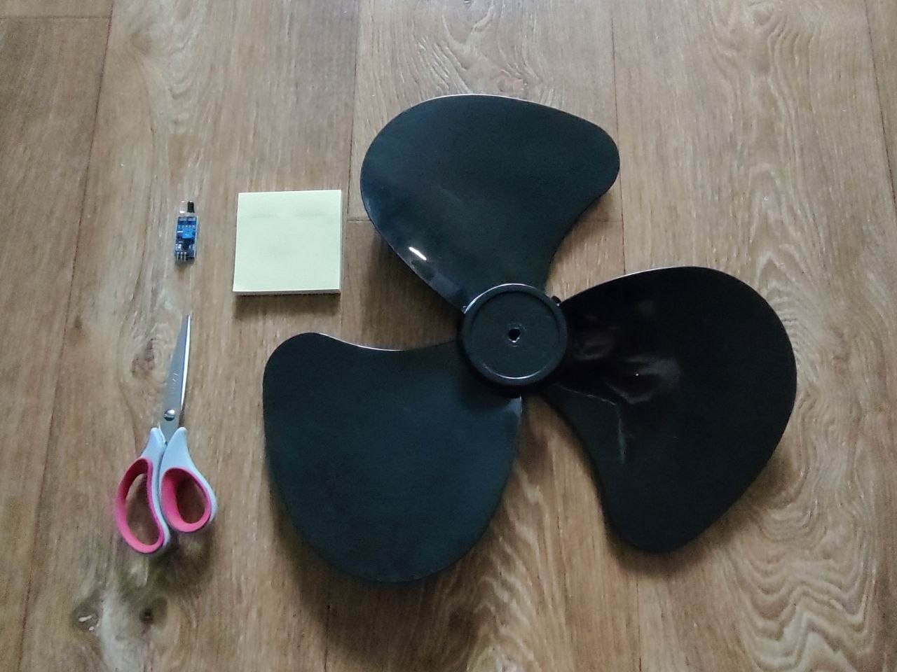
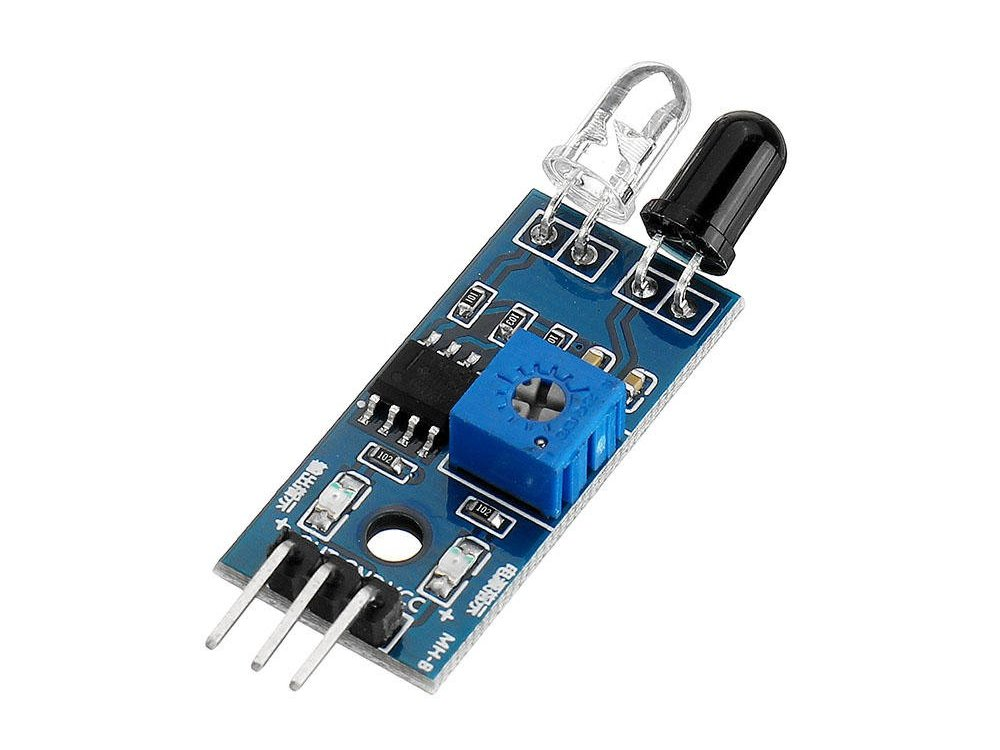
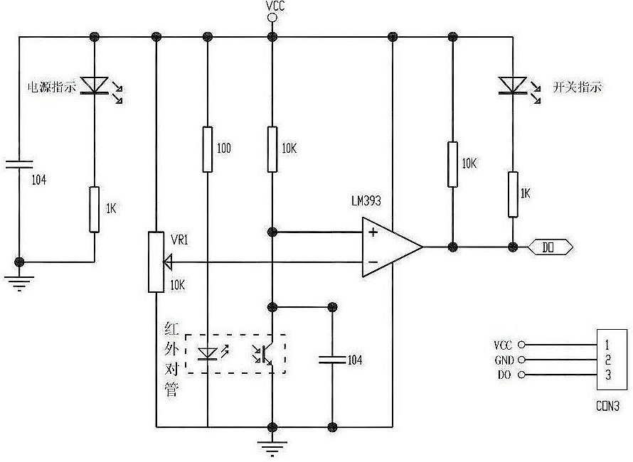
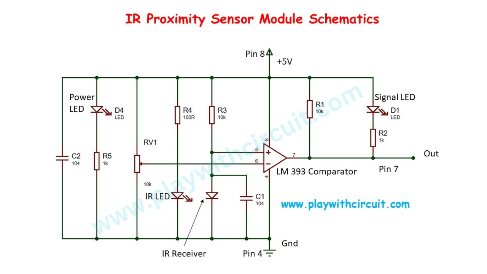
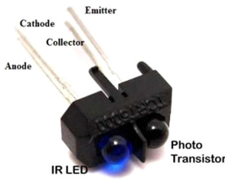
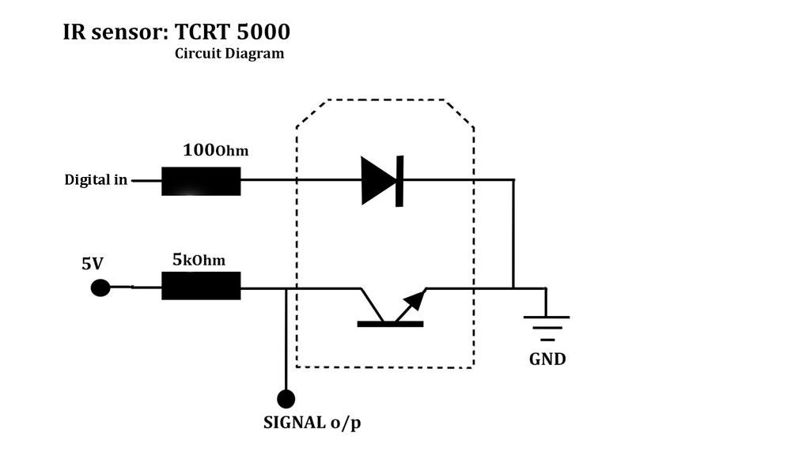

### Frequency measuring

- Two approaches for frequency measurement;  
- Timer/Counter 0 is used for system timer, Timer/Counter 1 is used for period measuring, Timer/Counter 2 generates test frequencies;
- Example 3 shows how to measure the fan speed (rotation frequency).  

  

  

  

  

  

  

---

### See also:  

- [LM393 - Dual differential comparator](https://www.ti.com/lit/ds/symlink/lm393.pdf?ts=1790835498806&ref_url=https%253A%252F%252Fwww.ti.com%252Fproduct%252Fde-de%252FLM393)  
- [TCRT5000 Reflective Optical Sensor](https://www.sunrom.com/p/tcrt5000-reflective-optical-sensor)  
- [AVR205: Frequency measurement made easy with tinyAVR and megaAVR](https://www.microchip.com/en-us/application-notes/an8365)  
